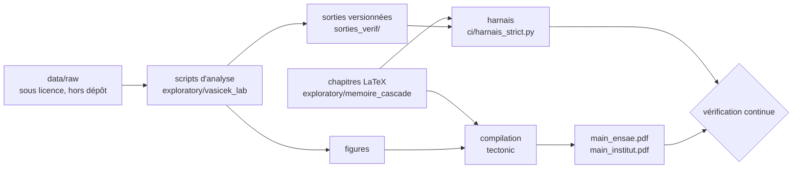

# Quantification du SCR lié à la non-conformité au règlement DORA

**Une cascade dirigée entre les cinq piliers**

[](https://github.com/kelian19/memoire-scr-dora/actions/workflows/verification.yml)
[](https://doi.org/10.5281/zenodo.22874524)
[](LICENSE)
[](LICENSE-CONTENU.md)

Mémoire d'actuariat présenté devant l'**ENSAE Paris** (Mastère spécialisé, filière Actuariat) pour
l'admission à l'**Institut des actuaires**. Travail conduit chez **Nexialog Consulting**.

- **Auteur** : Kélian Kaddouri
- **Encadrement** : Hugo Rapior (Nexialog Consulting), Caroline Hillairet (ENSAE Paris)

Ce dépôt est la version publique du projet : le mémoire, le code qui en produit chaque nombre, les
sorties de ce code et la vérification continue qui les confronte. Le travail se poursuit dans un
dépôt privé, dont chaque version publiée ici est un export.

## Lire

| Document | Lien |
|---|---|
| Le mémoire, version ENSAE, 199 pages | [`main_ensae.pdf`](exploratory/memoire_cascade/main_ensae.pdf) |
| La version Institut des actuaires, 195 pages, sans le chapitre du stage | [`main_institut.pdf`](exploratory/memoire_cascade/main_institut.pdf) |
| Le matériel complémentaire (démonstrations, pièces justificatives, compléments) | [Zenodo, 10.5281/zenodo.22874524](https://doi.org/10.5281/zenodo.22874524) |
| Le support de soutenance | [`soutenance_memoire_DORA.pdf`](exploratory/slides/soutenance_memoire_DORA.pdf) |
| Le cours de préparation à la soutenance, chapitre par chapitre | [`cours_memoire.pdf`](exploratory/vasicek_lab/notes/cours_memoire.pdf) |

Les deux PDF du mémoire sont les fichiers déposés le 30 septembre 2026, identiques à l'octet.

## Le travail en bref

**La question.** Combien coûte en capital de ne pas se conformer au règlement DORA
(UE 2022/2554), et jusqu'où ce chiffre peut-il être affirmé ?

**Le modèle.** La dépendance entre les cinq piliers du règlement est portée par une cascade
dirigée plutôt que par une copule, et sa normalisation de Leontief en garantit la stabilité.
L'état de conformité pilote le capital par une couche multi-états. La sévérité suit une loi de
Pareto généralisée calibrée sur des pertes opérationnelles réelles, la fréquence une binomiale
négative.

**Les résultats.**

- Sur les quatre canaux que la conformité déplace, le besoin de capital du secteur passe de
  **6 049 à 20 188 M€**, soit un facteur **3,34**. C'est un besoin au sens de l'ORSA : il n'existe
  aucun module DORA en Formule Standard.
- La **direction** de la contagion n'est pas identifiable sur les données publiques, alors que sa
  co-occurrence l'est. Le capital est donc **borné** sur les 1 024 matrices admissibles, entre
  **6 858 et 8 697 M€**, et la largeur de la bande est le coût de l'ignorance, connu d'avance.
- La limite devient un livrable : le mémoire spécifie le registre d'incidents qui lèverait cette
  ignorance et chiffre ce que chaque donnée rapporterait.

## Comment les chiffres sont produits, puis vérifiés

Aucun nombre du mémoire n'est écrit à la main. Chaque nombre publié est imprimé par un script
dont la sortie est versionnée, et un harnais confronte le texte à ces sorties, section par
section.



La base de pertes étant sous licence, elle ne figure pas dans le dépôt : ce sont les **sorties**
des scripts qui sont versionnées. La traçabilité remplace ainsi la reproductibilité complète, et
la vérification continue rejoue tout ce qui peut l'être sans la donnée : le harnais des chiffres
et la compilation des deux versions, à chaque push.

## Reproduire

```bash
git clone https://github.com/kelian19/memoire-scr-dora.git
cd memoire-scr-dora
python -m venv .venv && .venv/bin/pip install -r requirements.txt   # Windows : .venv\Scripts\pip

python ci/harnais_strict.py                                         # chaque nombre confirmé par son script
python exploratory/memoire_cascade/refaire_tout.py --sans-harnais   # compile les deux versions et contrôle les PDF
```

La compilation demande [tectonic](https://tectonic-typesetting.github.io), version 0.16.9. Les
images de signature n'étant pas distribuées, un PDF compilé depuis ce dépôt a une page de garde
sans signatures. Les scripts qui lisent la donnée brute (`data/raw/`) exigent les bases sous
licence.

## Ce que cette version ne contient pas

- **La donnée brute.** La base SAS OpRisk Global Data est sous licence, et aucune base n'est
  redistribuée ici.
- **L'identité des quatre assureurs** du chapitre des bilans réels. Le mémoire les anonymise
  (assureurs non-vie A et B, vie C et D) ; ici, le script 65, sa sortie et le script 95 qui la
  relit portent `Identite A` à `Identite D` à la place des raisons sociales. Aucun nombre ne
  change.
- **Les valeurs vraies des graines du questionnaire d'élicitation.** Elles servent à noter les
  experts et perdraient leur pouvoir de séparation une fois publiées. La sortie du script 105 les
  masque ; le protocole d'animation et les scripts 26 et 26b, qui en portent des versions
  antérieures, restent hors de cette version tant que l'élicitation est ouverte.
- **Les journaux de travail, les notes internes et les noms des praticiens consultés.**

## Organisation du dépôt

```text
.
├── exploratory/
│   ├── memoire_cascade/       le mémoire : chapitres LaTeX, compilation, harnais, contrôles
│   ├── vasicek_lab/           scripts d'analyse numérotés par thème, modules partagés, figures
│   ├── cascade_qualitative/   modèle qualitatif de la cascade et questionnaire d'élicitation
│   ├── video_cascade/         animation de la cascade
│   └── slides/                support de soutenance
├── sorties_verif/             sorties versionnées des scripts, lues par le harnais
├── src/                       premiers modules du projet, encore importés par certains scripts
├── outputs/figures/           figures de la première version, dont deux restent au mémoire
├── ci/                        contrôles de la vérification continue
└── data/                      vide : la donnée brute reste hors dépôt
```

## Versions

Chaque version est une étiquette git, `v1.1.0` étant la version déposée le 30 septembre 2026.
L'historique est dans [`CHANGELOG.md`](CHANGELOG.md). Pour signaler une erreur ou proposer une
correction, voir [`CONTRIBUTING.md`](CONTRIBUTING.md).

## Citer

Voir [`CITATION.cff`](CITATION.cff) (GitHub propose aussi « Cite this repository »). Le matériel
complémentaire se cite par son DOI, [10.5281/zenodo.22874524](https://doi.org/10.5281/zenodo.22874524).

## Licence

Le code est sous licence [MIT](LICENSE). Le texte et les figures du mémoire sont sous
[CC BY 4.0](LICENSE-CONTENU.md), à l'exception des figures externes, des logos et des signatures,
dont les droits restent à leurs titulaires.
